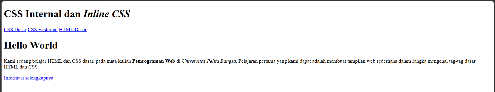
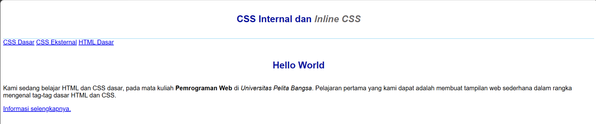
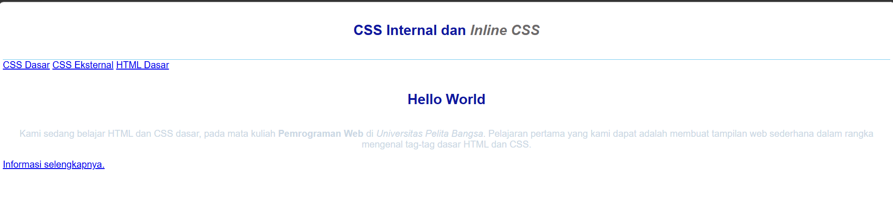
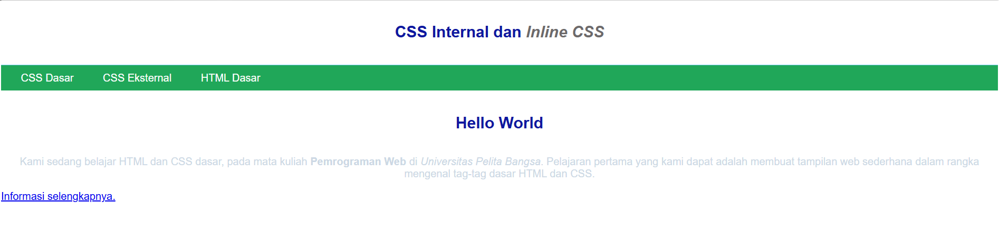
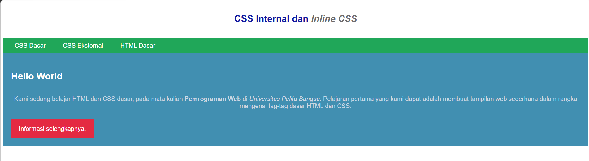
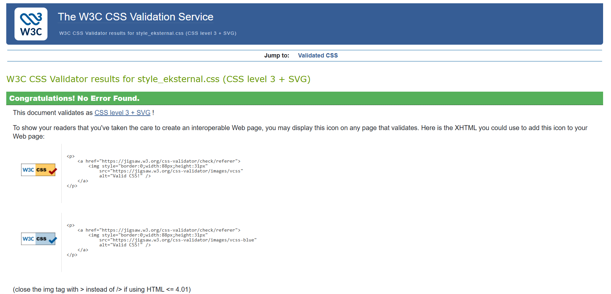
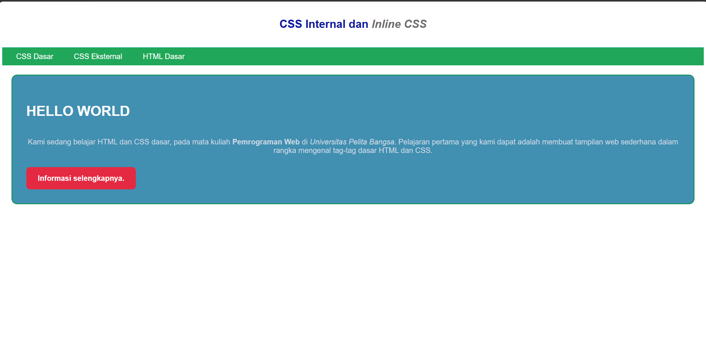

# Praktikum 3 - CSS Dasar

## Identitas Praktikum

- **Mata Kuliah:** Pemrograman Web
- **Praktikum:** 3
- **Materi:** CSS Dasar
- **Program Studi:** Teknik Informatika

## A. Tujuan Praktikum

1. Memahami konsep dasar CSS.
2. Memahami aturan penulisan CSS.
3. Memahami selector sebagai pengontrol CSS.
4. Membuat pengaturan CSS pada HTML.

## B. Struktur Folder

```text
Lab3Web/
├── lab2_css_dasar.html
├── style_eksternal.css
├── README.md
└── screenshot/
```

## C. Langkah Kerja Praktikum

### 1. Membuat Dokumen HTML

Membuat dokumen HTML dengan struktur dasar yang terdiri dari header, navigasi, judul, paragraf, dan hyperlink.

**Screenshot:**



### 2. Mendeklarasikan CSS Internal

Menambahkan CSS internal menggunakan tag `<style>` pada bagian `<head>` untuk mengatur jenis font, warna, ukuran teks, dan tampilan header.

**Screenshot:**



### 3. Menambahkan Inline CSS

Menambahkan CSS secara langsung pada tag paragraf menggunakan atribut `style` untuk mengatur posisi dan warna teks.

**Screenshot:**



### 4. Membuat CSS Eksternal

Membuat file `style_eksternal.css` dan menghubungkannya dengan HTML menggunakan tag `<link>`.

**Screenshot:**



### 5. Menambahkan CSS Selector

Menggunakan ID Selector (`#intro`) dan Class Selector (`.button` dan `.btn-primary`) untuk mengatur tampilan elemen HTML.

**Screenshot:**



## D. Validasi CSS

Melakukan validasi file CSS menggunakan W3C CSS Validation Service untuk memeriksa kesesuaian penulisan CSS.

**Screenshot:**



## E. Eksperimen CSS

Melakukan eksperimen dengan mengubah dan menambahkan properti serta nilai CSS, seperti background, border, padding, margin, font-size, dan border-radius.

**Screenshot:**



## F. Pertanyaan dan Tugas

1. Melakukan eksperimen perubahan properti dan nilai CSS.
2. Menjelaskan perbedaan selector `h1` dan `#intro h1`.
3. Menjelaskan prioritas CSS internal, eksternal, dan inline.
4. Menjelaskan prioritas ID Selector dan Class Selector.

## G. Kesimpulan

Berdasarkan praktikum yang telah dilakukan, dapat disimpulkan bahwa CSS digunakan untuk mengatur tampilan halaman web agar lebih menarik dan terstruktur.

Praktikum ini memberikan pemahaman mengenai tiga metode penulisan CSS, yaitu internal, eksternal, dan inline. Selain itu, praktikum juga mempelajari penggunaan element selector, ID Selector, dan Class Selector untuk mengatur tampilan elemen HTML.

## H. Teknologi yang Digunakan

- HTML5
- CSS3
- Visual Studio Code
- Web Browser
- W3C CSS Validation Service

---

**Praktikum 3 - Pemrograman Web**  
**Materi: CSS Dasar**
